# Hybrid De Novo Enzyme Design & Evolutionary Refinement Platform
### RFD4-Proteina / RFD3 Scaffolding &bull; 4-Gate Biophysical Validation &bull; AIzymes Refinement

---

## Setup & Initial Execution

### 1. Export API Credentials
```bash
export TAMARIND_API_KEY="your-tamarind-api-key"
```

### 2. Pre-Flight Validation Check (Zero-Cost Dry Run)
Validates the input structure, motif scaffolding contig, and active-site residue settings directly against the live Tamarind Bio API at $0 cost:
```bash
# RFD3 (Scaffolding):
python3 hackathon_extensions/cli.py stage1 --engine rfd3 --input test_pipeline/1qji_json.json --dry-run

# RFD4-Proteina (All-Atom joint codesign):
python3 hackathon_extensions/cli.py stage1 --engine rfd4 --input test_pipeline/1qji_json.json --dry-run
```

### 3. Live Stage 1 Generative Execution
Submits the generative diffusion task to Tamarind Bio, tracks execution, and writes resulting candidate PDB structures to `outputs/stage1_candidates/`:
```bash
python3 hackathon_extensions/cli.py stage1 --engine rfd3 --input test_pipeline/1qji_json.json
```

---

## Command Reference

| Task | Command | Description |
|---|---|---|
| **Dry Run (Pre-flight)** | `python3 hackathon_extensions/cli.py stage1 --engine rfd3 --input test_pipeline/1qji_json.json --dry-run` | Zero-cost pre-flight check against Tamarind Bio API |
| **Live Stage 1 (RFD3)** | `python3 hackathon_extensions/cli.py stage1 --engine rfd3 --input test_pipeline/1qji_json.json` | Submits RFD3 diffusion + LigandMPNN sequence design |
| **Live Stage 1 (RFD4)** | `python3 hackathon_extensions/cli.py stage1 --engine rfd4 --input test_pipeline/1qji_json.json` | 32D latent-guided joint all-atom codesign |
| **Stage 2 Validation** | `python3 hackathon_extensions/cli.py stage2 --candidates "outputs/stage1_candidates/*.pdb"` | Runs 4-gate biophysical validation triage |
| **Stage 1 + 2 Triage** | `python3 hackathon_extensions/cli.py stage1-2 --engine rfd3 --input test_pipeline/1qji_json.json` | Generates scaffolds and immediately ranks with 4 gates |
| **Full Hybrid Pipeline** | `python3 hackathon_extensions/cli.py full --input "CC(=O)Oc1ccccc1" --input-case case3` | End-to-end: Ingestion $\rightarrow$ Stage 1 $\rightarrow$ Stage 2 $\rightarrow$ Stage 3 AIzymes |
| **Standalone AIzymes** | `python3 hackathon_extensions/cli.py aizymes-standalone --structure "WT.pdb" --generations 3` | Evolutionary optimization on existing holo-complex |

---

## 📁 Input Scenarios Supported

The pipeline automatically handles all 4 hackathon input scenarios via `--input`:

```bash
# Case 1: Annotated Complex (.cif / .pdb with theozyme)
python3 hackathon_extensions/cli.py stage1 --input "test_pipeline/PDB_1QJI_theozyme_HEHHMY.cif" --input-case case1

# Case 2a: Unannotated Holo Structure (loop redesign / partial diffusion)
python3 hackathon_extensions/cli.py stage1 --input "scaffold_holo.pdb" --input-case case2a

# Case 2b: SMILES + Catalytic Mechanism (e.g. Cys-His-Asp triad)
python3 hackathon_extensions/cli.py stage1 --input "substrate.smi" --input-case case2b

# Case 3: Substrate SMILES Only (Theozyme-First or Binder-First shortcut)
python3 hackathon_extensions/cli.py stage1 --input "CC(=O)Oc1ccccc1" --input-case case3
```

---

## Pipeline Architecture & Data Flow

```mermaid
flowchart TD
    subgraph Inputs["Flexible Input Ingestion"]
        C1["Case 1: Annotated Holo mmCIF / PDB"]
        C2a["Case 2a: Unannotated Holo / Active Site Crop"]
        C2b["Case 2b: SMILES + Catalytic Mechanism"]
        C3["Case 3: SMILES Only (Theozyme / Binder First)"]
    end

    subgraph Stage1["Stage 1: Generative De Novo Design"]
        Router1{"Compute Router & VRAM Guardrail"}
        RFD4["RFD4-Proteina Joint All-Atom Codesign\n(32D Latent Guidance, Thinking Budget)\nBackend: Tamarind REST / Modal AI"]
        RFD3["RFD3 Backbone Scaffolding\n+ LigandMPNN Sequence Packing\nBackend: Tamarind / ETH Euler"]
    end

    subgraph Stage2["Stage 2: 4-Gate Biophysical Validation"]
        G1["Gate 1: Co-Folding & Affinity\nBoltz-2 / AlphaFold3 (iPAE < 10, pLDDT > 70)\nAttack Dist <= 3.3 A, Affinity > 0.72\nBackend: Tamarind / Modal"]
        G2["Gate 2: Active-Site Preorganization\nPLACER 100 Ensemble Samples (>= 30-50% active)\nBürgi-Dunitz 100-120 deg, Delta S Penalty\nBackend: Modal Serverless GPU"]
        G3["Gate 3: Stability & Sequence Fitness\nThermoMPNN Delta Delta G <= 1.5 kcal/mol (ETH Euler)\nESM3 / SaProt Log-Likelihood >= -2.5 (Modal)"]
        G4["Gate 4: Dynamics & QM/MM Energetics\n1. OpenMM Explicit Solvent MD (NAC persist >= 0.25)\n2. FieldTools Catalytic Electric Field > 10 MV/cm\n3. ORCA QM/MM Barrier (Delta G#_enz < Delta G#_water)\nBackend: ETH Euler RTX 2080 / Slurm CPU"]
        Scorecard["Design Scorecards & Consolidated Triage\n(scorecards.json & validation_summary.csv)"]
    end

    subgraph Stage3["Stage 3: AIzymes Evolutionary Refinement"]
        Bridge["AIzymes Bridge\n(WT PDB Map, Freeze Catalytic Triad,\nSelect 4-8 A Second-Shell Mutations,\nGenerate enzdes.cst & field_target.dat)"]
        Evolution["AIzymes Controller\n(Multi-Round Boltzmann Selection,\nMulti-Objective Rosetta REU + Catalytic + Efield)"]
        Winner["Optimized De Novo Enzyme Lead"]
    end

    Inputs --> Stage1
    Stage1 --> Router1
    Router1 --> RFD4
    Router1 --> RFD3
    RFD4 --> Stage2
    RFD3 --> Stage2
    Stage2 --> G1
    G1 -->|Pass| G2
    G2 -->|Pass| G3
    G3 -->|Pass| G4
    G4 -->|Pass| Scorecard
    Scorecard --> Stage3
    Stage3 --> Bridge --> Evolution --> Winner
```



---

## 🖥️ Compute Backend Routing

Hardware memory safety guardrails automatically route each job to appropriate compute backends, strictly preventing low-VRAM nodes (e.g. ETH Euler RTX 2080 8GB) from running heavy all-atom diffusion models:

| Operation | Default Backend | Minimum Hardware | Fallback Backend |
|---|---|---|---|
| **RFD4-Proteina Diffusion** | **Tamarind Bio API** | Cloud A100 (40-80 GB) | Modal AI Serverless |
| **RFD3 Backbone Diffusion** | **Tamarind Bio API** | Cloud GPU | ETH Euler / Local |
| **LigandMPNN Sequence Design** | **Local / Tamarind** | CPU / 4GB GPU | Modal AI |
| **Gate 1: Boltz-2 / AF3** | **Tamarind Bio API** | Cloud A100 | Modal AI |
| **Gate 2: PLACER Ensemble** | **Modal AI Serverless** | 4× A100 Parallel | Local multi-core |
| **Gate 3: ThermoMPNN** | **ETH Euler Cluster** | Slurm CPU / RTX 2080 | Local |
| **Gate 4: OpenMM & ORCA** | **ETH Euler Cluster** | Slurm GPU / CPU | Local |
| **Stage 3: AIzymes Evolution** | **Local / Euler** | Slurm CPU / Rosetta | Local |

---

## 🧪 Testing & Verification

Run the comprehensive unit and pre-flight validation suite:
```bash
# Run all 24 unit tests:
pytest hackathon_extensions/tests/ -v

# Run dry-run test for Stage 1:
pytest hackathon_extensions/tests/test_stage1_dryrun.py -v

# Run 4-gate validation dry-run:
pytest hackathon_extensions/tests/test_stage2_dryrun.py -v
```

---

## 📊 Output Artifacts

All results are saved into structured folders under `outputs/`:
* `outputs/stage1_candidates/`: Generated PDB structures, FASTA files, and `candidates_manifest.json`.
* `outputs/stage2_validation/`: Consolidated `scorecards.json` and `validation_summary.csv` ranking candidates across all 4 gates.
* `outputs/stage3_aizymes/`: Evolutionary trajectory, Pareto fronts, and final refined enzyme variants.
