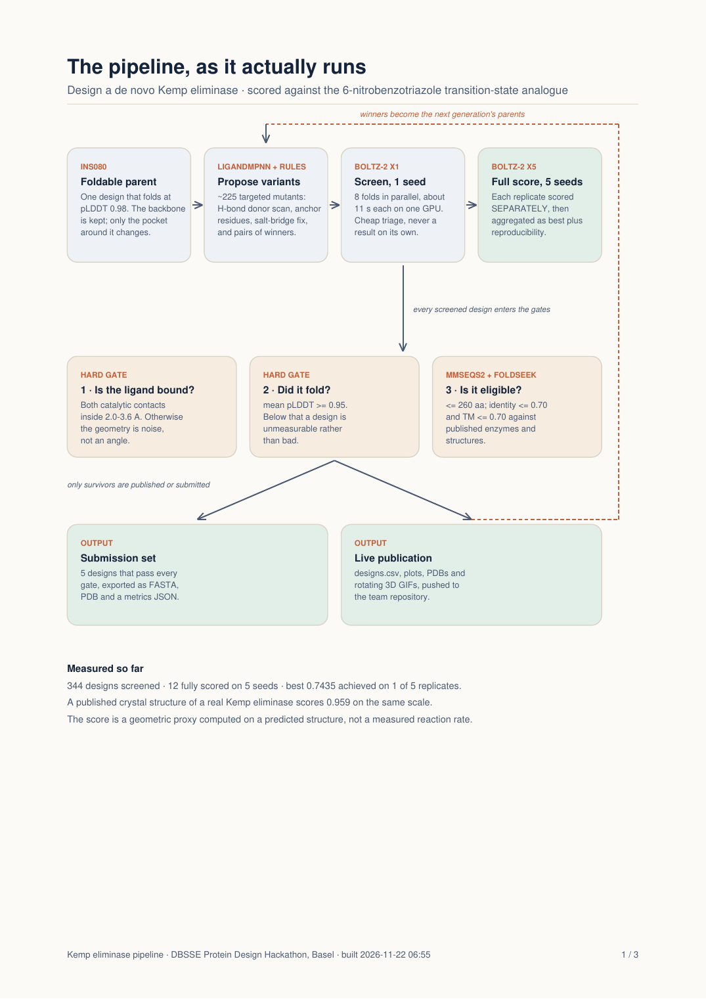

# Kemp eliminase design — pipeline, scoring and findings

De novo enzyme design for the Kemp elimination of 5-nitrobenzisoxazole, scored
against the **6-nitrobenzotriazole (6NT)** transition-state analogue.
DBSSE Protein Design Hackathon, Basel, November 2026.

**Live results, plots, structures and rotating 3D views: [`results/`](results/)**

---

## How the pipeline works



*(Full three-page version with per-stage inputs/outputs and rationale:
[`reference/pipeline.pdf`](reference/pipeline.pdf))*

### In words

**1. Start from a design that folds.** Generating fresh backbones gave
sequences the structure predictor could not place confidently — pLDDT
0.41–0.47, where the *same* sequence predicted twice gave catalytic distances
of 2.6 Å and 13.6 Å. At that confidence a design is unmeasurable, so ranking
it ranks noise. We instead take one design that folds at pLDDT 0.98, keep its
backbone, and change only the pocket.

**2. Propose a few hundred targeted variants.** One or two substitutions each,
at positions we *measured* as responsible, with the catalytic Asp102/Gln46
frozen. Proposals come from LigandMPNN (with the native residue forbidden, or
it simply returns the parent) and from rule-based ladders that vary steric
bulk around the oxyanion.

**3. Screen each one cheaply.** A single Boltz-2 prediction per design, eight
in parallel on one GPU, ~11 s each. A full score costs five predictions, so
screening first lets us look at five times more ideas for the same compute.

**4. Throw most of them away — in this order.**

| gate | rule | why it exists |
|---|---|---|
| **bound ligand** | both `d_base` and `d_oxy` inside 2.0–3.6 Å | a dihedral measured on a drifted ligand is noise, not an angle. This filter overturned three results we had already announced |
| **foldability** | mean pLDDT ≥ 0.95 | below it a design is *unmeasurable*, not bad. Note pLDDT does **not** detect ligand loss — one design folded at 0.967 with the ligand 9.7 Å away |
| **eligibility** | ≤ 260 aa, identity ≤ 0.70, TM ≤ 0.70 | the organisers' hard limits |

**5. Score the survivors properly.** Five Boltz-2 seeds, **each scored
separately**, then aggregated. Never by averaging the geometry and scoring
once — that reported **0.624** for a design where 0 of 5 replicates scored,
and simultaneously hid a real **0.743** on another.

**6. Feed the winners back.** Whatever scored becomes the next generation's
parent. Pairs of winning single mutations raised the in-band rate from 10% to
47%; triples gave no further gain, which is how we knew to stop.

### What gets scored

The organisers' four criteria, all computed on a **predicted** structure:

- **iPDE** — Boltz-2's own estimate of error in protein–ligand distances
  (`complex_ipde`; an error, so smaller is better)
- **Geometry** — distances, angles and dihedrals between the catalytic base,
  the H-bond donor and the ligand
- **Catalytic base burial** — Cα atoms within 12 Å of the base
- **Consistency** — agreement across the five seeds

It is a weighted **geometric** mean: one zero sub-score makes the whole design
0.000.

---

## Read these first

| file | why |
|---|---|
| [`docs/good_practices.md`](docs/good_practices.md) | **Start here.** The measurement rules, each one traced to something that fooled us |
| [`docs/run_monitor.md`](docs/run_monitor.md) | The challenge's scoring criteria, eligibility limits, and the 15-minute run checklist |
| [`docs/LOOP_DESIGN.md`](docs/LOOP_DESIGN.md) | Everything measured, corrections included. Supersedes `LESSONS.md` where they differ |
| [`docs/LESSONS.md`](docs/LESSONS.md) | The first day's findings, retractions kept |
| [`docs/SETUP.md`](docs/SETUP.md) | Environment and tool setup |

### The three rules that matter most

1. **A dihedral measured on an unbound ligand is noise, not an angle.**
2. **Score each replicate separately.** Quote results as *"best achievable,
   n/5 reproducibility"*, never a bare average.
3. **pLDDT below 0.95 means unmeasurable, not bad** — and it does not detect
   ligand loss.

---

## Setting up

The analysis side installs from the lock file. The model side does not, and
deliberately so: Boltz-2, RFdiffusion3, LigandMPNN and Rosetta each need their
own CUDA or compiled environment, and `openmm`, `openff-toolkit`,
`openmmforcefields` and `pdbfixer` are conda-forge only, so pinning them in
`uv.lock` would make it unbuildable.

```bash
uv sync                                    # scoring, gates, plots, the PDF (24 pkgs)
conda env create -f envs/mm.yml            # OpenMM + OpenFF + freesasa
conda env create -f envs/her2_boltz2.yml   # Boltz-2
conda env create -f envs/foundry.yml       # RFdiffusion3 / RF3
conda env create -f envs/aizymes.yml       # LigandMPNN runtime
conda env create -f envs/novelty.yml       # Foldseek + MMseqs2
```

Then edit the interpreter paths at the top of [`kemp/config.py`](kemp/config.py)
for your machine. `envs/pip-*.txt` are exact freezes from the machine that
produced every number here; `envs/uv-apnovo-requirements.txt` covers the
separate uv venv used for APNovo's metrics code.

Rosetta is expected at `~/opt/rosetta` with `rosetta_scripts`, `relax` and
`match` built.

### Check it works

```bash
make test        # 120 tests, seconds, no GPU required
```

---

## Running it

```bash
python scripts/build_library.py --max 600                     # targeted variants
python scripts/parallel_fold.py \
       --manifest outputs/library/library.json --workers 8    # 1-seed screen
python scripts/annotate_screens.py                            # literature filters
python scripts/score_inband.py --until 11:30                  # 5-seed the in-band set
python scripts/bank_submissions.py 30                         # gates, novelty, export 5
python scripts/live_publish_team.py --push                    # tables, plots, PDBs, GIFs
```

`scripts/supervisor.py --until HH:MM` runs the whole loop unattended.

| script | does |
|---|---|
| `score_finalist.py <id>` | 5 seeds, scored per replicate |
| `rescore_all.py --write` | re-score every finalist from the structures on disk |
| `make_gifs.py` | rotating 3D views of designs scoring on ≥4/5 |
| `make_pipeline_pdf.py` | rebuilds the diagram with current numbers |
| `make_enzdes_cst.py` / `make_6nt_params.py` | Rosetta constraint and ligand files |

---

## Layout

```
kemp/                the library
  official.py          the organisers' scoring; use score_replicates()
  objective.py         dense ranking objective, degeneracy alarm, protocol stamp
  litfilters.py        literature activity filters + the Gln46 pinner
  gates.py / novelty.py   eligibility: length, identity, TM
  runners.py           LigandMPNN and Boltz-2 drivers
inputs/
  theozymes/           the supplied Asp/Gln/6NT motif
  supplied/            the hackathon slides and the three filter sheets
reference/             pipeline PDF, enzdes .cst, 6NT params, example designs
envs/                  one conda environment per tool, plus pip freezes
results/               live output, regenerated as the run proceeds
```

---

## What a score here is, and is not

Everything is computed on a **predicted** structure, folded in
single-sequence mode (verified: the MSA server returns depth 1 for these de
novo sequences, so MSA and no-MSA give bit-identical folds). No pocket
constraints are used in scoring, so the ligand is placed from sequence alone.

A good score means the predicted active site has a productive shape under the
organisers' metric. It is **not** a reaction rate, and nothing here
demonstrates catalytic activity.
