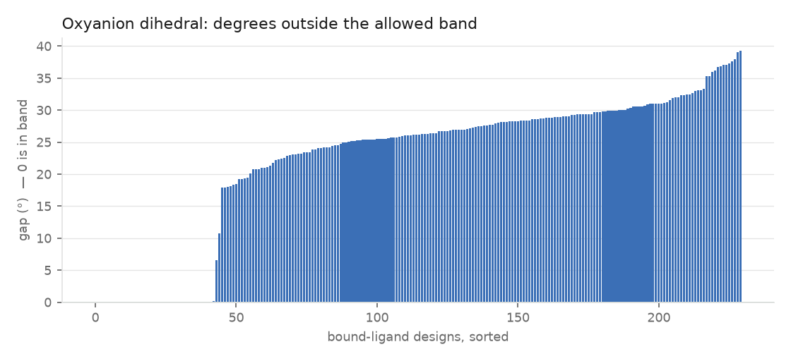
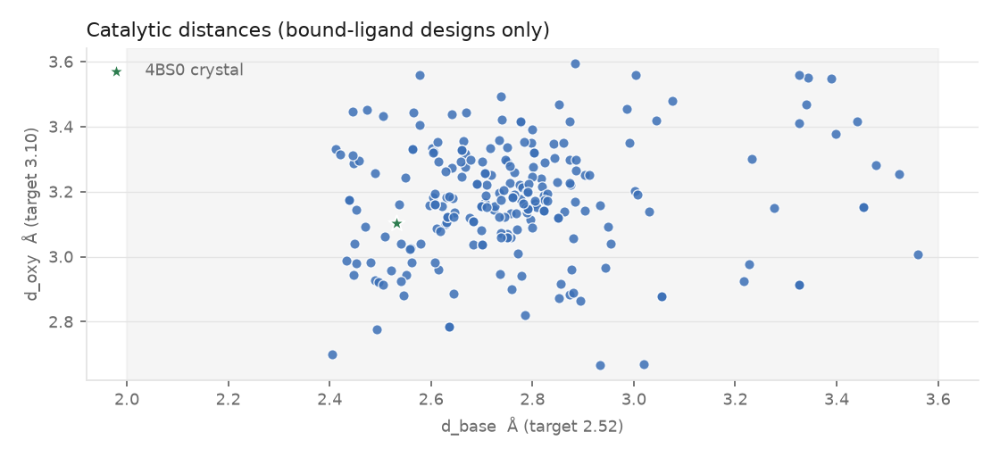
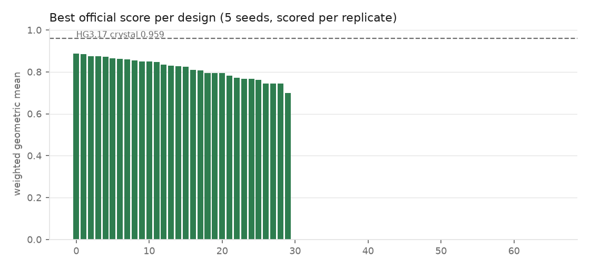
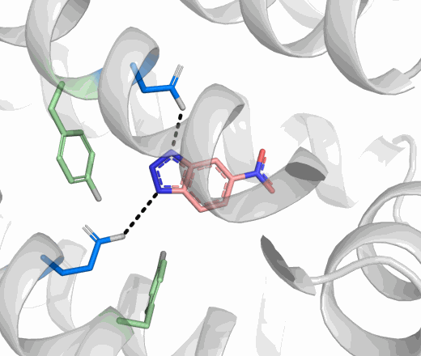
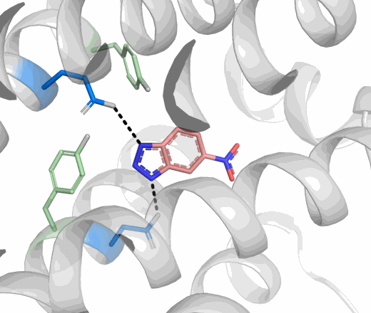
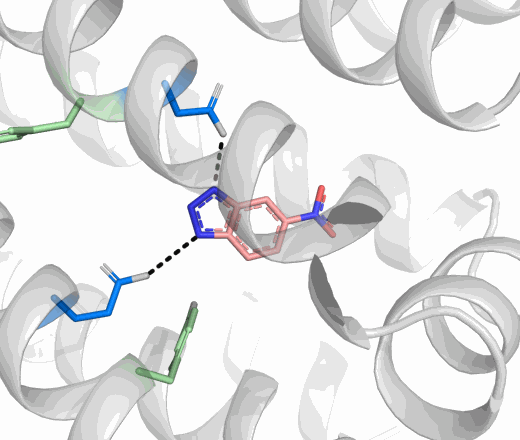
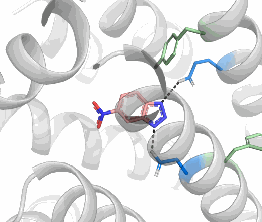
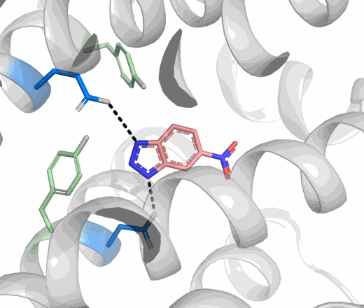
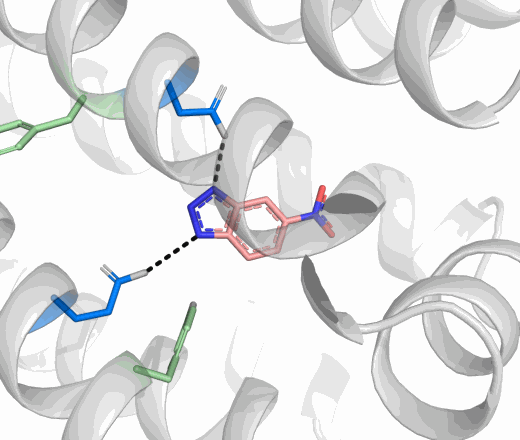

# Kemp eliminase designs — live results

_Auto-updated live. Last: 2026-11-22 12:59:00_

| | |
|---|---|
| **Best official score** | **0.8967** (4/5 seeds, `L3_I23V_M45Y_V84L`) |
| Designs measured | 418 |
| With a bound ligand | 230 |
| Fully scored (5 seeds) | 66 |
| Scoring on ≥1 replicate | **33** |
| HG3.17 crystal (yardstick) | 0.959 |
| HG3.17 folded with MSA | 0.834 |

## Plots

### Dihedral Gap



### Distances



### Official Score



## How to read a score here

The official metric is a weighted **geometric** mean: one zero sub-score makes the whole design 0.000. Every design is scored on **5 Boltz-2 seeds, each scored separately**, then aggregated — never by averaging the geometry and scoring once. Averaging a bimodal rotamer produced a phantom 0.624 here for a design where 0/5 replicates scored.

So a result is quoted as **best achievable + reproducibility**: "0.743 on 1/5 seeds", never a bare average.

`bound_ligand` is the first filter — geometry is meaningless unless both `d_base` and `d_oxy` sit inside 2.0–3.6 Å. `mean_plddt` below 0.95 means *unmeasurable*, not bad.

## ✅ Designs that score

| design | best | seeds | per-replicate | limiting | pLDDT |
|---|---|---|---|---|---|
| `L2_pair_I23V_M45Y` | **0.8866** | 5/5 | `[0.810589, 0.697506, 0.872514, 0.789027, 0.886562]` | orient_base | 0.978 |
| `L2_pair_I23L_V84L` | **0.8839** | 5/5 | `[0.856189, 0.744759, 0.804401, 0.763203, 0.88391]` | orient_base | 0.978 |
| `L2_pair_I23L_V84I` | **0.8760** | 5/5 | `[0.812504, 0.72493, 0.769877, 0.726007, 0.87603]` | oxy | 0.978 |
| `L2_triple_I23L_M88F_V84L` | **0.8748** | 5/5 | `[0.831596, 0.797377, 0.838907, 0.780729, 0.874841]` | orient_base | 0.976 |
| `L_E_shell_I23V` | **0.8730** | 3/5 | `[0.872968, 0.826288, 0.0, 0.0, 0.832384]` | orient_base | 0.977 |
| `L2_triple_V84I_I23V_M88F` | **0.8657** | 3/5 | `[0.865695, 0.838791, 0.81056, 0.0, 0.0]` | orient_oxy | 0.970 |
| `L_E_shell_I23L` | **0.8617** | 5/5 | `[0.832968, 0.767098, 0.843188, 0.817074, 0.86167]` | orient_oxy | 0.979 |
| `L2_pair_V84I_M45Y` | **0.8592** | 4/5 | `[0.850435, 0.821269, 0.859225, 0.826256, 0.0]` | orient_oxy | 0.980 |
| `L2_pair_V84I_I23V` | **0.8536** | 5/5 | `[0.794239, 0.839636, 0.853574, 0.762198, 0.831248]` | orient_base | 0.977 |
| `L2_triple_I23L_V84I_M88F` | **0.8508** | 4/5 | `[0.829388, 0.0, 0.797676, 0.850842, 0.823516]` | orient_oxy | 0.973 |
| `L2_pair_M88F_M45Y` | **0.8487** | 5/5 | `[0.848685, 0.825073, 0.836115, 0.799532, 0.777376]` | orient_base | 0.978 |
| `L_E_shell_V84M` | **0.8465** | 2/5 | `[0.846513, 0.0, 0.736303, 0.0, 0.0]` | orient_oxy | 0.979 |
| `L_E_shell_V84I` | **0.8359** | 4/5 | `[0.835871, 0.778985, 0.820481, 0.790692, 0.0]` | oxy | 0.977 |
| `L2_pair_I23L_V84M` | **0.8308** | 1/5 | `[0.830814, 0.0, 0.0, 0.0, 0.0]` | orient_oxy | 0.979 |
| `L2_pair_I23L_M88F` | **0.8266** | 1/5 | `[0.826629, 0.0, 0.0, 0.0, 0.0]` | orient_oxy | 0.976 |
| `L_E_shell_V84L` | **0.8258** | 2/5 | `[0.82584, 0.0, 0.792937, 0.0, 0.0]` | oxy | 0.977 |
| `L2_pair_I23L_M88A` | **0.8090** | 4/5 | `[0.806883, 0.0, 0.808959, 0.638684, 0.614787]` | oxy | 0.975 |
| `L2_pair_M88F_V84L` | **0.8065** | 2/5 | `[0.784179, 0.0, 0.0, 0.0, 0.806454]` | orient_oxy | 0.974 |
| `L_D_seq_anchor_R127A_M45A` | **0.7956** | 1/5 | `[0.795622, 0.0, 0.0, 0.0, 0.0]` | orient_oxy | 0.978 |
| `L2_pair_R127A_M45A` | **0.7956** | 1/5 | `[0.795622, 0.0, 0.0, 0.0, 0.0]` | orient_oxy | 0.978 |

### Rotating 3D views

Cartoon protein, **6NT** analogue in salmon sticks, catalytic **Asp102 / Gln46** in blue, the **Tyr42 / Tyr103** pinners in green, and the two scored contacts as dashed lines. Rendered from the seed that scored.

**L2_pair_I23L_V84I — best 0.8760, 5/5 seeds**



**L2_pair_I23L_V84L — best 0.8839, 5/5 seeds**



**L2_pair_I23V_M45Y — best 0.8866, 5/5 seeds**



**L2_pair_M88F_M45Y — best 0.8487, 5/5 seeds**



**L2_pair_V84I_I23V — best 0.8536, 5/5 seeds**



**L2_pair_V84I_M45Y — best 0.8592, 4/5 seeds**



## ❌ Designs that score 0.000 — and which term killed them

| limiting term | designs |
|---|---|
| `oxy` | 12 |
| `base` | 12 |
| `orient_oxy` | 9 |
| `cons` | 3 |

| design | limiting | base | oxy | ipde | or_base | or_oxy | bury | cons | pLDDT |
|---|---|---|---|---|---|---|---|---|---|
| `L_B_anchor_M45Y` | oxy | 0.299 | 0.000 | 0.924 | 0.523 | 0.000 | 1.000 | 0.000 | 0.978 |
| `L_E_shell_F26W` | oxy | 0.250 | 0.000 | 0.934 | 0.906 | 0.246 | 1.000 | 0.000 | 0.977 |
| `L_E_shell_M88A` | base | 0.000 | 0.000 | 0.888 | 0.259 | 0.000 | 1.000 | 0.000 | 0.973 |
| `L_D_seq_donor_R127G_Y103W` | orient_oxy | 0.159 | 0.302 | 0.922 | 0.365 | 0.000 | 1.000 | 0.000 | 0.955 |
| `L2_pair_I23V_V84L` | cons | 0.173 | 0.632 | 0.933 | 0.845 | 0.257 | 1.000 | 0.000 | 0.977 |
| `L2_pair_M88F_F26W` | base | 0.000 | 0.000 | 0.918 | 0.711 | 0.214 | 1.000 | 0.000 | 0.973 |
| `L2_pair_V84L_F26W` | base | 0.000 | 0.000 | 0.927 | 0.198 | 0.000 | 1.000 | 0.000 | 0.977 |
| `g1_l26W` | oxy | 0.250 | 0.000 | 0.934 | 0.906 | 0.246 | 1.000 | 0.000 | 0.977 |
| `ins026_d84_V84R` | oxy | 0.644 | 0.000 | 0.936 | 0.317 | 0.000 | 1.000 | 0.880 | 0.970 |
| `ins040_ladder26_F26W` | orient_oxy | 0.036 | 0.016 | 0.934 | 0.711 | 0.000 | 1.000 | 0.000 | 0.972 |
| `ins066_ladder23_I23F` | orient_oxy | 0.671 | 0.111 | 0.948 | 0.409 | 0.000 | 1.000 | 0.934 | 0.976 |
| `ins056_ladder49_L49V` | orient_oxy | 0.735 | 0.821 | 0.934 | 0.465 | 0.000 | 1.000 | 0.903 | 0.972 |
| `g1_seq127M` | oxy | 0.836 | 0.000 | 0.948 | 0.386 | 0.364 | 1.000 | 0.861 | 0.978 |
| `ins079_r103_42_F42Y_H103F` | oxy | 0.860 | 0.311 | 0.933 | 0.479 | 0.314 | 1.000 | 0.926 | 0.977 |
| `ins070_ladder27_V27F` | oxy | 0.312 | 0.000 | 0.906 | 0.442 | 0.000 | 1.000 | 0.106 | 0.955 |
| `ins062_ladder45_M45F` | orient_oxy | 0.636 | 0.672 | 0.932 | 0.371 | 0.000 | 1.000 | 0.877 | 0.969 |
| `ins061_ladder45_M45I` | oxy | 0.090 | 0.000 | 0.923 | 0.375 | 0.000 | 1.000 | 0.000 | 0.970 |
| `ins004_r42_F42Y` | oxy | 0.583 | 0.000 | 0.943 | 0.356 | 0.268 | 1.000 | 0.900 | 0.973 |
| `ins059_ladder45_M45V` | orient_oxy | 0.727 | 0.908 | 0.938 | 0.523 | 0.000 | 1.000 | 0.858 | 0.974 |
| `ins057_ladder49_L49W` | oxy | 0.050 | 0.000 | 0.931 | 0.785 | 0.458 | 1.000 | 0.000 | 0.969 |

## Literature activity filters

From the supplied sheets (Risso 2020; Privett 2012; Alexandrova 2008), all for this reaction. Reference: G1 2.64 Å, G2 166.5°, H3 = 0 charged residues within 4 Å of the base, S2 ≥ 0.60.

| design | G1 Å | G2 ° | H3 | S2 |
|---|---|---|---|---|
| `L_E_shell_I23L` | 2.629 | 150.62 | 2 ⚠️ | 0.5 |
| `L2_pair_V84I_I23V` | 2.757 | 145.22 | 2 ⚠️ | 0.5 |
| `L_E_shell_I23V` | 2.56 | 153.26 | 1 ⚠️ | 0.5 |
| `L2_pair_V84I_M45Y` | 2.551 | 149.6 | 2 ⚠️ | 0.455 |
| `L2_pair_M88F_M45Y` | 2.453 | 152.87 | 2 ⚠️ | 0.5 |
| `L2_pair_I23V_M45Y` | 2.596 | 155.27 | 2 ⚠️ | 0.455 |
| `L2_pair_I23L_V84L` | 2.536 | 145.64 | 2 ⚠️ | 0.5 |
| `L_E_shell_V84I` | 2.611 | 146.83 | 2 ⚠️ | 0.5 |
| `L2_pair_I23L_V84I` | 2.549 | 146.52 | 2 ⚠️ | 0.5 |
| `L2_pair_V84I_M88F` | 2.489 | 150.47 | 2 ⚠️ | 0.5 |
| `L2_pair_I23L_M88A` | 2.615 | 156.54 | 2 ⚠️ | 0.556 |
| `L2_pair_I23V_R127G` | 2.602 | 147.69 | 0 ✅ | 0.6 |
| `L_B_anchor_M45W` | 3.076 | 155.7 | 2 ⚠️ | 0.545 |
| `L_B_anchor_M45Y` | 2.802 | 151.79 | 2 ⚠️ | 0.455 |
| `L_B_anchor_L49F` | 3.453 | 151.21 | 2 ⚠️ | 0.5 |

## Submitted designs

**[SUBMISSION_TABLE.md](SUBMISSION_TABLE.md) — the submitted 20, with the reason each one is in.**

| file | what |
|---|---|
| [`designs.fasta`](designs.fasta) | the **20 submitted**, `base=102 oxy=46` headers |
| [`designs_qualifying.fasta`](designs_qualifying.fasta) | **all 31 qualifying** designs |
| [`designs/`](designs/) | a FASTA **and all five folded PDBs** for every qualifying design |
| [`SUBMISSION_TABLE.md`](SUBMISSION_TABLE.md) | the 20, ranked, with reasoning |
| [`RANKINGS.md`](RANKINGS.md) | all designs ranked under each of 11 metrics |
| [`BIOPHYSICS.md`](BIOPHYSICS.md) | stability, thermal, biochemistry in full |
| [`ARCHIVE.md`](ARCHIVE.md) | append-only record of every design that ever scored |

## How each score is computed

The official metric is a **weighted geometric mean** of seven subscores:

```
S = PROD_i  s_i ** w_i        equivalently  S = exp( SUM_i w_i * ln s_i )
```

**One zero kills the design.** If any `s_i` is 0 then S = 0 no matter how good the other six are. That single property shaped the whole pipeline: a batch of all-zero designs is unrankable, so we optimise against a *dense* surrogate (degrees outside the allowed dihedral band) and score with the real metric.

| term | measured quantity | formula | target / window |
|---|---|---|---|
| `base` | `d_base` — Asp102 OD2 ⋯ ligand N3 | window score | target **2.52 Å**, window 2.0–3.6 Å |
| `ipde` | Boltz-2 `complex_ipde` (an *error*) | `max(0, 1 − iPDE/8.0)` | lower is better |
| `oxy` | `d_oxy` — Gln46 NE2 ⋯ ligand N1 | window score | target **3.1 Å**, window 2.0–3.6 Å |
| `orient_base` | angle + dihedral at the base | `min(s_angle, s_dihedral)` | — |
| `orient_oxy` | angle + dihedral at the oxyanion | `min(s_angle, s_dihedral)` | — |
| `bury` | mean Cα neighbours at 6/8/12 Å | linear ramp | 0 at ≤3, 1 at ≥15 |
| `cons` | SD of `d_base` across the 5 seeds | `max(0, 1 − σ/0.5)` | lower is better |

### Window score (distances and angles)

```
s = 0                        if v outside [lo, hi]
s = 1 − |v − t| / span       otherwise
span = (hi − t) if v ≥ t else (t − lo)
```

1.0 at the target, linear decay to 0 at whichever window edge is nearer. Angles use target **120.0°**, window **80.0–160.0°**.

### Dihedral score — the term that decided everything

Two allowed sp2 bands, **130–230°** and **310–50°** (wrapping through 0). Ideal 180° (or 0°), half-width 60°:

```
s_dih = max(0, 1 − |Δ| / 60)     Δ = deviation from the nearer band's ideal
```

Everything in **50–130°** and **230–310°** scores **exactly 0**. The team's `rfd4_design_045` sat at **86.1°** — dead in the first gap — which is why it scored 0.000 on all five seeds despite good distances. Three mutations moved it into band.

`orient_* = min(angle, dihedral)`, never an average: per SUBMISSION.md *"the angle and the in-plane terms do not average — the worse of the two decides."* A perfect angle cannot rescue a bad torsion.

### How a design on this page got its number

1. Fold the sequence with the 6NT ligand in Boltz-2 — **5 seeds**.
2. Measure every quantity **from each folded structure**, never from stored numbers.
3. Gate: both distances inside 2.0–3.6 Å, mean pLDDT ≥ 0.95.
4. **Score each replicate separately**, then aggregate the *scores*.
5. Report median, best, worst and **reproducibility = n/5 non-zero**.

---

## How each score is computed

The official metric is a **weighted geometric mean** of seven subscores:

```
S = PROD_i  s_i ** w_i        equivalently  S = exp( SUM_i w_i * ln s_i )
```

**One zero kills the design.** If any `s_i` is 0 then S = 0 no matter how good the other six are. That single property shaped the whole pipeline: a batch of all-zero designs is unrankable, so we optimise against a *dense* surrogate (degrees outside the allowed dihedral band) and score with the real metric.

| term | measured quantity | formula | target / window |
|---|---|---|---|
| `base` | `d_base` — Asp102 OD2 ⋯ ligand N3 | window score | target **2.52 Å**, window 2.0–3.6 Å |
| `ipde` | Boltz-2 `complex_ipde` (an *error*) | `max(0, 1 − iPDE/8.0)` | lower is better |
| `oxy` | `d_oxy` — Gln46 NE2 ⋯ ligand N1 | window score | target **3.1 Å**, window 2.0–3.6 Å |
| `orient_base` | angle + dihedral at the base | `min(s_angle, s_dihedral)` | — |
| `orient_oxy` | angle + dihedral at the oxyanion | `min(s_angle, s_dihedral)` | — |
| `bury` | mean Cα neighbours at 6/8/12 Å | linear ramp | 0 at ≤3, 1 at ≥15 |
| `cons` | SD of `d_base` across the 5 seeds | `max(0, 1 − σ/0.5)` | lower is better |

### Window score (distances and angles)

```
s = 0                        if v outside [lo, hi]
s = 1 − |v − t| / span       otherwise
span = (hi − t) if v ≥ t else (t − lo)
```

1.0 at the target, linear decay to 0 at whichever window edge is nearer. Angles use target **120.0°**, window **80.0–160.0°**.

### Dihedral score — the term that decided everything

Two allowed sp2 bands, **130–230°** and **310–50°** (wrapping through 0). Ideal 180° (or 0°), half-width 60°:

```
s_dih = max(0, 1 − |Δ| / 60)     Δ = deviation from the nearer band's ideal
```

Everything in **50–130°** and **230–310°** scores **exactly 0**. The team's `rfd4_design_045` sat at **86.1°** — dead in the first gap — which is why it scored 0.000 on all five seeds despite good distances. Three mutations moved it into band.

`orient_* = min(angle, dihedral)`, never an average: per SUBMISSION.md *"the angle and the in-plane terms do not average — the worse of the two decides."* A perfect angle cannot rescue a bad torsion.

### How a design on this page got its number

1. Fold the sequence with the 6NT ligand in Boltz-2 — **5 seeds**.
2. Measure every quantity **from each folded structure**, never from stored numbers.
3. Gate: both distances inside 2.0–3.6 Å, mean pLDDT ≥ 0.95.
4. **Score each replicate separately**, then aggregate the *scores*.
5. Report median, best, worst and **reproducibility = n/5 non-zero**.

---

## How each score is computed

The official metric is a **weighted geometric mean** of seven subscores:

```
S = PROD_i  s_i ** w_i        equivalently  S = exp( SUM_i w_i * ln s_i )
```

**One zero kills the design.** If any `s_i` is 0 then S = 0 no matter how good the other six are. That single property shaped the whole pipeline: a batch of all-zero designs is unrankable, so we optimise against a *dense* surrogate (degrees outside the allowed dihedral band) and score with the real metric.

| term | measured quantity | formula | target / window |
|---|---|---|---|
| `base` | `d_base` — Asp102 OD2 ⋯ ligand N3 | window score | target **2.52 Å**, window 2.0–3.6 Å |
| `ipde` | Boltz-2 `complex_ipde` (an *error*) | `max(0, 1 − iPDE/8.0)` | lower is better |
| `oxy` | `d_oxy` — Gln46 NE2 ⋯ ligand N1 | window score | target **3.1 Å**, window 2.0–3.6 Å |
| `orient_base` | angle + dihedral at the base | `min(s_angle, s_dihedral)` | — |
| `orient_oxy` | angle + dihedral at the oxyanion | `min(s_angle, s_dihedral)` | — |
| `bury` | mean Cα neighbours at 6/8/12 Å | linear ramp | 0 at ≤3, 1 at ≥15 |
| `cons` | SD of `d_base` across the 5 seeds | `max(0, 1 − σ/0.5)` | lower is better |

### Window score (distances and angles)

```
s = 0                        if v outside [lo, hi]
s = 1 − |v − t| / span       otherwise
span = (hi − t) if v ≥ t else (t − lo)
```

1.0 at the target, linear decay to 0 at whichever window edge is nearer. Angles use target **120.0°**, window **80.0–160.0°**.

### Dihedral score — the term that decided everything

Two allowed sp2 bands, **130–230°** and **310–50°** (wrapping through 0). Ideal 180° (or 0°), half-width 60°:

```
s_dih = max(0, 1 − |Δ| / 60)     Δ = deviation from the nearer band's ideal
```

Everything in **50–130°** and **230–310°** scores **exactly 0**. The team's `rfd4_design_045` sat at **86.1°** — dead in the first gap — which is why it scored 0.000 on all five seeds despite good distances. Three mutations moved it into band.

`orient_* = min(angle, dihedral)`, never an average: per SUBMISSION.md *"the angle and the in-plane terms do not average — the worse of the two decides."* A perfect angle cannot rescue a bad torsion.

### How a design on this page got its number

1. Fold the sequence with the 6NT ligand in Boltz-2 — **5 seeds**.
2. Measure every quantity **from each folded structure**, never from stored numbers.
3. Gate: both distances inside 2.0–3.6 Å, mean pLDDT ≥ 0.95.
4. **Score each replicate separately**, then aggregate the *scores*.
5. Report median, best, worst and **reproducibility = n/5 non-zero**.

---

## How each score is computed

The official metric is a **weighted geometric mean** of seven subscores:

```
S = PROD_i  s_i ** w_i        equivalently  S = exp( SUM_i w_i * ln s_i )
```

**One zero kills the design.** If any `s_i` is 0 then S = 0 no matter how good the other six are. That single property shaped the whole pipeline: a batch of all-zero designs is unrankable, so we optimise against a *dense* surrogate (degrees outside the allowed dihedral band) and score with the real metric.

| term | measured quantity | formula | target / window |
|---|---|---|---|
| `base` | `d_base` — Asp102 OD2 ⋯ ligand N3 | window score | target **2.52 Å**, window 2.0–3.6 Å |
| `ipde` | Boltz-2 `complex_ipde` (an *error*) | `max(0, 1 − iPDE/8.0)` | lower is better |
| `oxy` | `d_oxy` — Gln46 NE2 ⋯ ligand N1 | window score | target **3.1 Å**, window 2.0–3.6 Å |
| `orient_base` | angle + dihedral at the base | `min(s_angle, s_dihedral)` | — |
| `orient_oxy` | angle + dihedral at the oxyanion | `min(s_angle, s_dihedral)` | — |
| `bury` | mean Cα neighbours at 6/8/12 Å | linear ramp | 0 at ≤3, 1 at ≥15 |
| `cons` | SD of `d_base` across the 5 seeds | `max(0, 1 − σ/0.5)` | lower is better |

### Window score (distances and angles)

```
s = 0                        if v outside [lo, hi]
s = 1 − |v − t| / span       otherwise
span = (hi − t) if v ≥ t else (t − lo)
```

1.0 at the target, linear decay to 0 at whichever window edge is nearer. Angles use target **120.0°**, window **80.0–160.0°**.

### Dihedral score — the term that decided everything

Two allowed sp2 bands, **130–230°** and **310–50°** (wrapping through 0). Ideal 180° (or 0°), half-width 60°:

```
s_dih = max(0, 1 − |Δ| / 60)     Δ = deviation from the nearer band's ideal
```

Everything in **50–130°** and **230–310°** scores **exactly 0**. The team's `rfd4_design_045` sat at **86.1°** — dead in the first gap — which is why it scored 0.000 on all five seeds despite good distances. Three mutations moved it into band.

`orient_* = min(angle, dihedral)`, never an average: per SUBMISSION.md *"the angle and the in-plane terms do not average — the worse of the two decides."* A perfect angle cannot rescue a bad torsion.

### How a design on this page got its number

1. Fold the sequence with the 6NT ligand in Boltz-2 — **5 seeds**.
2. Measure every quantity **from each folded structure**, never from stored numbers.
3. Gate: both distances inside 2.0–3.6 Å, mean pLDDT ≥ 0.95.
4. **Score each replicate separately**, then aggregate the *scores*.
5. Report median, best, worst and **reproducibility = n/5 non-zero**.

---

## How each score is computed

The official metric is a **weighted geometric mean** of seven subscores:

```
S = PROD_i  s_i ** w_i        equivalently  S = exp( SUM_i w_i * ln s_i )
```

**One zero kills the design.** If any `s_i` is 0 then S = 0 no matter how good the other six are. That single property shaped the whole pipeline: a batch of all-zero designs is unrankable, so we optimise against a *dense* surrogate (degrees outside the allowed dihedral band) and score with the real metric.

| term | measured quantity | formula | target / window |
|---|---|---|---|
| `base` | `d_base` — Asp102 OD2 ⋯ ligand N3 | window score | target **2.52 Å**, window 2.0–3.6 Å |
| `ipde` | Boltz-2 `complex_ipde` (an *error*) | `max(0, 1 − iPDE/8.0)` | lower is better |
| `oxy` | `d_oxy` — Gln46 NE2 ⋯ ligand N1 | window score | target **3.1 Å**, window 2.0–3.6 Å |
| `orient_base` | angle + dihedral at the base | `min(s_angle, s_dihedral)` | — |
| `orient_oxy` | angle + dihedral at the oxyanion | `min(s_angle, s_dihedral)` | — |
| `bury` | mean Cα neighbours at 6/8/12 Å | linear ramp | 0 at ≤3, 1 at ≥15 |
| `cons` | SD of `d_base` across the 5 seeds | `max(0, 1 − σ/0.5)` | lower is better |

### Window score (distances and angles)

```
s = 0                        if v outside [lo, hi]
s = 1 − |v − t| / span       otherwise
span = (hi − t) if v ≥ t else (t − lo)
```

1.0 at the target, linear decay to 0 at whichever window edge is nearer. Angles use target **120.0°**, window **80.0–160.0°**.

### Dihedral score — the term that decided everything

Two allowed sp2 bands, **130–230°** and **310–50°** (wrapping through 0). Ideal 180° (or 0°), half-width 60°:

```
s_dih = max(0, 1 − |Δ| / 60)     Δ = deviation from the nearer band's ideal
```

Everything in **50–130°** and **230–310°** scores **exactly 0**. The team's `rfd4_design_045` sat at **86.1°** — dead in the first gap — which is why it scored 0.000 on all five seeds despite good distances. Three mutations moved it into band.

`orient_* = min(angle, dihedral)`, never an average: per SUBMISSION.md *"the angle and the in-plane terms do not average — the worse of the two decides."* A perfect angle cannot rescue a bad torsion.

### How a design on this page got its number

1. Fold the sequence with the 6NT ligand in Boltz-2 — **5 seeds**.
2. Measure every quantity **from each folded structure**, never from stored numbers.
3. Gate: both distances inside 2.0–3.6 Å, mean pLDDT ≥ 0.95.
4. **Score each replicate separately**, then aggregate the *scores*.
5. Report median, best, worst and **reproducibility = n/5 non-zero**.

---

## How each score is computed

The official metric is a **weighted geometric mean** of seven subscores:

```
S = PROD_i  s_i ** w_i        equivalently  S = exp( SUM_i w_i * ln s_i )
```

**One zero kills the design.** If any `s_i` is 0 then S = 0 no matter how good the other six are. That single property shaped the whole pipeline: a batch of all-zero designs is unrankable, so we optimise against a *dense* surrogate (degrees outside the allowed dihedral band) and score with the real metric.

| term | measured quantity | formula | target / window |
|---|---|---|---|
| `base` | `d_base` — Asp102 OD2 ⋯ ligand N3 | window score | target **2.52 Å**, window 2.0–3.6 Å |
| `ipde` | Boltz-2 `complex_ipde` (an *error*) | `max(0, 1 − iPDE/8.0)` | lower is better |
| `oxy` | `d_oxy` — Gln46 NE2 ⋯ ligand N1 | window score | target **3.1 Å**, window 2.0–3.6 Å |
| `orient_base` | angle + dihedral at the base | `min(s_angle, s_dihedral)` | — |
| `orient_oxy` | angle + dihedral at the oxyanion | `min(s_angle, s_dihedral)` | — |
| `bury` | mean Cα neighbours at 6/8/12 Å | linear ramp | 0 at ≤3, 1 at ≥15 |
| `cons` | SD of `d_base` across the 5 seeds | `max(0, 1 − σ/0.5)` | lower is better |

### Window score (distances and angles)

```
s = 0                        if v outside [lo, hi]
s = 1 − |v − t| / span       otherwise
span = (hi − t) if v ≥ t else (t − lo)
```

1.0 at the target, linear decay to 0 at whichever window edge is nearer. Angles use target **120.0°**, window **80.0–160.0°**.

### Dihedral score — the term that decided everything

Two allowed sp2 bands, **130–230°** and **310–50°** (wrapping through 0). Ideal 180° (or 0°), half-width 60°:

```
s_dih = max(0, 1 − |Δ| / 60)     Δ = deviation from the nearer band's ideal
```

Everything in **50–130°** and **230–310°** scores **exactly 0**. The team's `rfd4_design_045` sat at **86.1°** — dead in the first gap — which is why it scored 0.000 on all five seeds despite good distances. Three mutations moved it into band.

`orient_* = min(angle, dihedral)`, never an average: per SUBMISSION.md *"the angle and the in-plane terms do not average — the worse of the two decides."* A perfect angle cannot rescue a bad torsion.

### How a design on this page got its number

1. Fold the sequence with the 6NT ligand in Boltz-2 — **5 seeds**.
2. Measure every quantity **from each folded structure**, never from stored numbers.
3. Gate: both distances inside 2.0–3.6 Å, mean pLDDT ≥ 0.95.
4. **Score each replicate separately**, then aggregate the *scores*.
5. Report median, best, worst and **reproducibility = n/5 non-zero**.

---

## How each score is computed

The official metric is a **weighted geometric mean** of seven subscores:

```
S = PROD_i  s_i ** w_i        equivalently  S = exp( SUM_i w_i * ln s_i )
```

**One zero kills the design.** If any `s_i` is 0 then S = 0 no matter how good the other six are. That single property shaped the whole pipeline: a batch of all-zero designs is unrankable, so we optimise against a *dense* surrogate (degrees outside the allowed dihedral band) and score with the real metric.

| term | measured quantity | formula | target / window |
|---|---|---|---|
| `base` | `d_base` — Asp102 OD2 ⋯ ligand N3 | window score | target **2.52 Å**, window 2.0–3.6 Å |
| `ipde` | Boltz-2 `complex_ipde` (an *error*) | `max(0, 1 − iPDE/8.0)` | lower is better |
| `oxy` | `d_oxy` — Gln46 NE2 ⋯ ligand N1 | window score | target **3.1 Å**, window 2.0–3.6 Å |
| `orient_base` | angle + dihedral at the base | `min(s_angle, s_dihedral)` | — |
| `orient_oxy` | angle + dihedral at the oxyanion | `min(s_angle, s_dihedral)` | — |
| `bury` | mean Cα neighbours at 6/8/12 Å | linear ramp | 0 at ≤3, 1 at ≥15 |
| `cons` | SD of `d_base` across the 5 seeds | `max(0, 1 − σ/0.5)` | lower is better |

### Window score (distances and angles)

```
s = 0                        if v outside [lo, hi]
s = 1 − |v − t| / span       otherwise
span = (hi − t) if v ≥ t else (t − lo)
```

1.0 at the target, linear decay to 0 at whichever window edge is nearer. Angles use target **120.0°**, window **80.0–160.0°**.

### Dihedral score — the term that decided everything

Two allowed sp2 bands, **130–230°** and **310–50°** (wrapping through 0). Ideal 180° (or 0°), half-width 60°:

```
s_dih = max(0, 1 − |Δ| / 60)     Δ = deviation from the nearer band's ideal
```

Everything in **50–130°** and **230–310°** scores **exactly 0**. The team's `rfd4_design_045` sat at **86.1°** — dead in the first gap — which is why it scored 0.000 on all five seeds despite good distances. Three mutations moved it into band.

`orient_* = min(angle, dihedral)`, never an average: per SUBMISSION.md *"the angle and the in-plane terms do not average — the worse of the two decides."* A perfect angle cannot rescue a bad torsion.

### How a design on this page got its number

1. Fold the sequence with the 6NT ligand in Boltz-2 — **5 seeds**.
2. Measure every quantity **from each folded structure**, never from stored numbers.
3. Gate: both distances inside 2.0–3.6 Å, mean pLDDT ≥ 0.95.
4. **Score each replicate separately**, then aggregate the *scores*.
5. Report median, best, worst and **reproducibility = n/5 non-zero**.

---

## Stability — biochemistry, biophysics, thermodynamics

Every design here is folded, not measured in a tube. These columns ask a different question from the score above: *is this protein buildable at all?*

The **HG3.17 (4BS0) crystal structure is carried through as the control arm** — a real enzyme that has been expressed, purified, crystallised and kinetically characterised. It relaxes to **-3.271 REU/residue**, so every design below that beats it is better packed than the enzyme this reaction is actually run with.

### Verdict per design

Eligibility is the competition's rule set. Stability is **not** a competition criterion — it is a buildability check and was never used to rank anything.

A design is CLEAN when all of these hold: ThermoMPNN ΔΔG ≤ 1.5 kcal/mol (~3× the ~0.5 experimental error), instability index < 40, Rosetta relax per residue better than the HG3.17 control, MD drift ≤ 0.5 Å/ns, Rg swell ≤ 5%. FLAGGED names the term that failed rather than hiding it.

| design | repro | official | eligible | TM | identity | base/oxy | stability | why flagged |
|---|---|---|---|---|---|---|---|---|
| `L3_I23V_M45Y_V84I` | 5/5 | 0.8421 | – | – | – | None/None | ✅ CLEAN | – |
| `L_E_shell_I23L` | 5/5 | 0.8330 | ✅ NOVEL | 0.170 | 0.00 | 102/46 | ✅ CLEAN | – |
| `L2_triple_I23L_M88F_V84L` | 5/5 | 0.8316 | ✅ NOVEL | 0.174 | 0.00 | 102/46 | ✅ CLEAN | – |
| `L2_pair_V84I_I23V` | 5/5 | 0.8312 | ✅ NOVEL | 0.170 | 0.00 | 102/46 | ✅ CLEAN | – |
| `L2_pair_M88F_M45Y` | 5/5 | 0.8251 | ✅ NOVEL | 0.144 | 0.00 | 102/46 | ⚠️ FLAGGED | ddG +1.63 kcal/mol |
| `L2_pair_I23V_M45Y` | 5/5 | 0.8106 | ✅ NOVEL | 0.169 | 0.00 | 102/46 | ✅ CLEAN | – |
| `L2_pair_I23L_V84L` | 5/5 | 0.8044 | ✅ NOVEL | 0.137 | 0.00 | 102/46 | ✅ CLEAN | – |
| `L2_pair_I23L_V84I` | 5/5 | 0.7699 | ✅ NOVEL | 0.160 | 0.00 | 102/46 | ✅ CLEAN | – |
| `L2_pair_V84I_M45Y` | 4/5 | 0.8263 | ✅ NOVEL | 0.173 | 0.00 | 102/46 | ✅ CLEAN | – |
| `L2_triple_I23L_V84I_M88F` | 4/5 | 0.8235 | ✅ NOVEL | 0.136 | 0.00 | 102/46 | ✅ CLEAN | – |
| `L3_I23V_M45Y_V84L` | 4/5 | 0.8205 | – | – | – | None/None | ✅ CLEAN | – |
| `L_E_shell_V84I` | 4/5 | 0.7907 | ✅ NOVEL | 0.144 | 0.00 | 102/46 | ✅ CLEAN | – |
| `L2_pair_I23L_M88A` | 4/5 | 0.6387 | ✅ NOVEL | 0.170 | 0.00 | 102/46 | ⚠️ FLAGGED | ddG +2.21 kcal/mol |
| `L_E_shell_I23V` | 3/5 | 0.8263 | ✅ NOVEL | 0.170 | 0.00 | 102/46 | ✅ CLEAN | – |
| `L2_triple_V84I_I23V_M88F` | 3/5 | 0.8106 | ✅ NOVEL | 0.160 | 0.00 | 102/46 | ✅ CLEAN | – |
| `L3_I23V_V84I_M88F` | 3/5 | 0.8106 | – | – | – | None/None | ✅ CLEAN | – |
| `L2_pair_V84I_M88F` | 3/5 | 0.7320 | ✅ NOVEL | 0.144 | 0.00 | 102/46 | ✅ CLEAN | – |
| `L2_pair_I23V_R127G` | 3/5 | 0.5117 | ✅ NOVEL | 0.173 | 0.00 | 102/46 | ⚠️ FLAGGED | ddG +1.73 kcal/mol |
| `L_E_shell_V84M` | 2/5 | 0.0000 | ✅ NOVEL | 0.144 | 0.00 | 102/46 | ✅ CLEAN | – |
| `L_E_shell_V84L` | 2/5 | 0.0000 | ✅ NOVEL | 0.144 | 0.00 | 102/46 | ✅ CLEAN | – |

**17 eligible, 17 clean, 3 flagged.** A flagged design is still submitted: SUBMISSION.md ranks each design individually against other teams' entries, so a weaker one cannot drag the others down, and an occupied slot beats an empty one.

### Thermal — molecular dynamics

2 ns implicit-solvent (GBn2) MD at 350 K, protein only, identical settings for every run including the control. A folded protein's RMSD plateaus (drift ≈ 0); an unfolding one keeps climbing, and its radius of gyration swells.

| design | RMSD Å | max Å | drift Å/ns | Rg start → end Å | swell % |
|---|---|---|---|---|---|
| `L_E_shell_I23L` | 2.23 | 2.57 | +0.03 | 14.40 → 14.43 | +0.2 |
| `L2_triple_I23L_M88F_V84L` | 1.31 | 1.68 | +0.19 | 14.64 → 14.50 | -1.0 |
| `L2_pair_V84I_I23V` | 2.17 | 2.45 | +0.30 | 14.40 → 14.36 | -0.2 |
| `L2_pair_M88F_M45Y` | 1.59 | 2.25 | +0.08 | 14.43 → 14.33 | -0.7 |
| `L2_pair_I23V_M45Y` | 1.57 | 1.92 | +0.26 | 14.36 → 14.38 | +0.1 |

**Not a melting temperature.** Two nanoseconds of implicit solvent cannot unfold a stable protein, so a flat trace is weak evidence of stability while a rising one is strong evidence of a problem. Only the comparison between identically-run simulations means anything.

### Thermodynamics

`relax/res` — Rosetta relax total_score per residue, protein only; **lower is better packed**.
`ΔΔG` — ThermoMPNN, summed over each design's mutations relative to the parent shell. **Positive = destabilising.** The sign was verified empirically, not assumed: a self-mutation scores exactly 0.000, →Pro +2.06, →Gly +1.36, hydrophobic→charged +2.06. Experimental error on a measured ΔΔG is ~0.5 kcal/mol, so anything under that is indistinguishable from zero.

| design | repro | official | relax/res | ΔΔG kcal/mol | mutations |
|---|---|---|---|---|---|
| `L3_I23V_M45Y_V84I` | 5/5 | 0.8421 | **–** | – | – |
| `L_E_shell_I23L` | 5/5 | 0.8330 | **-3.626** | +0.25 | I23L |
| `L2_triple_I23L_M88F_V84L` | 5/5 | 0.8316 | **-3.647** | +1.05 | I23L+V84L+M88F |
| `L2_pair_V84I_I23V` | 5/5 | 0.8312 | **-3.596** | +0.41 | I23V+V84I |
| `L2_pair_M88F_M45Y` | 5/5 | 0.8251 | **-3.586** | +1.63 | M45Y+M88F |
| `L2_pair_I23V_M45Y` | 5/5 | 0.8106 | **-3.546** | +1.07 | I23V+M45Y |
| `L2_pair_I23L_V84L` | 5/5 | 0.8044 | **-3.618** | +0.14 | I23L+V84L |
| `L2_pair_I23L_V84I` | 5/5 | 0.7699 | **-3.646** | +0.31 | I23L+V84I |
| `L2_pair_V84I_M45Y` | 4/5 | 0.8263 | **-3.460** | +0.79 | M45Y+V84I |
| `L2_triple_I23L_V84I_M88F` | 4/5 | 0.8235 | **-3.620** | +1.21 | I23L+V84I+M88F |
| `L3_I23V_M45Y_V84L` | 4/5 | 0.8205 | **–** | – | – |
| `L_E_shell_V84I` | 4/5 | 0.7907 | **-3.661** | +0.06 | V84I |
| `L2_pair_I23L_M88A` | 4/5 | 0.6387 | **-3.577** | +2.21 | I23L+M88A |
| `L_E_shell_I23V` | 3/5 | 0.8263 | **-3.578** | +0.35 | I23V |
| `L2_triple_V84I_I23V_M88F` | 3/5 | 0.8106 | **-3.603** | +1.32 | I23V+V84I+M88F |
| `L3_I23V_V84I_M88F` | 3/5 | 0.8106 | **–** | – | – |
| `L2_pair_V84I_M88F` | 3/5 | 0.7320 | **-3.575** | +0.97 | V84I+M88F |
| `L2_pair_I23V_R127G` | 3/5 | 0.5117 | **-3.640** | +1.73 | I23V+R127G |
| `L_E_shell_V84M` | 2/5 | 0.0000 | **-3.663** | +0.20 | V84M |
| `L_E_shell_V84L` | 2/5 | 0.0000 | **-3.668** | -0.10 | V84L |
| **`REF_HG3.17_4BS0`** (control) | – | – | **-3.271** | – | reference enzyme |

### Biophysics — fold and surface

`core` — buried hydrophobics (relative SASA < 0.15) ÷ length. `exp_hyd` / `exp_chg` — residues with relative SASA > 0.40. High exposed charge favours soluble expression.

| design | core | exp_hyd % | exp_chg % | SASA Ų | pLDDT | iPDE |
|---|---|---|---|---|---|---|
| `L3_I23V_M45Y_V84I` | 0.340 | 9.1 | 55.6 | 7653 | 0.979 | 0.47 |
| `L_E_shell_I23L` | 0.333 | 9.1 | 51.1 | 7506 | 0.979 | 0.44 |
| `L2_triple_I23L_M88F_V84L` | 0.340 | 9.1 | 46.7 | 7484 | 0.976 | 0.52 |
| `L2_pair_V84I_I23V` | 0.367 | 9.1 | 46.7 | 7649 | 0.977 | 0.50 |
| `L2_pair_M88F_M45Y` | 0.340 | 7.6 | 51.1 | 7634 | 0.978 | 0.49 |
| `L2_pair_I23V_M45Y` | 0.340 | 7.6 | 53.3 | 7469 | 0.978 | 0.49 |
| `L2_pair_I23L_V84L` | 0.333 | 9.1 | 53.3 | 7516 | 0.978 | 0.44 |
| `L2_pair_I23L_V84I` | 0.353 | 9.1 | 51.1 | 7501 | 0.978 | 0.45 |
| `L2_pair_V84I_M45Y` | 0.340 | 7.6 | 55.6 | 7427 | 0.980 | 0.47 |
| `L2_triple_I23L_V84I_M88F` | 0.353 | 9.1 | 48.9 | 7625 | 0.973 | 0.55 |
| `L3_I23V_M45Y_V84L` | 0.333 | 7.6 | 48.9 | 7502 | 0.976 | 0.51 |
| `L_E_shell_V84I` | 0.353 | 9.1 | 55.6 | 7577 | 0.977 | 0.49 |
| `L2_pair_I23L_M88A` | 0.347 | 9.1 | 51.1 | 7682 | 0.975 | 0.65 |
| `L_E_shell_I23V` | 0.353 | 9.1 | 55.6 | 7575 | 0.977 | 0.51 |
| `L2_triple_V84I_I23V_M88F` | 0.340 | 9.1 | 53.3 | 7695 | 0.970 | 0.61 |
| `L3_I23V_V84I_M88F` | 0.340 | 9.1 | 53.3 | 7695 | 0.970 | 0.61 |
| `L2_pair_V84I_M88F` | 0.353 | 9.1 | 53.3 | 7649 | 0.973 | 0.58 |
| `L2_pair_I23V_R127G` | 0.353 | 9.1 | 50.0 | 7471 | 0.976 | 0.49 |
| `L_E_shell_V84M` | 0.360 | 9.1 | 51.1 | 7524 | 0.979 | 0.52 |
| `L_E_shell_V84L` | 0.367 | 9.1 | 51.1 | 7535 | 0.977 | 0.52 |
| **`REF_HG3.17_4BS0`** (control) | 0.357 | 6.5 | 19.6 | 11108 | – | – |

### Biochemistry — sequence

Instability index < 40 is the classical Guruprasad threshold for a protein predicted stable *in vivo*. GRAVY below zero is hydrophilic.

| design | len | pI | net charge | GRAVY | instability | arom % | Cys |
|---|---|---|---|---|---|---|---|
| `L3_I23V_M45Y_V84I` | 150 | 4.67 | -17 | -0.39 | 32.2 | 8.7 | 1 |
| `L_E_shell_I23L` | 150 | 4.67 | -17 | -0.37 | 32.3 | 8.0 | 1 |
| `L2_triple_I23L_M88F_V84L` | 150 | 4.67 | -17 | -0.37 | 32.8 | 8.7 | 1 |
| `L2_pair_V84I_I23V` | 150 | 4.67 | -17 | -0.36 | 31.7 | 8.0 | 1 |
| `L2_pair_M88F_M45Y` | 150 | 4.67 | -17 | -0.38 | 33.3 | 9.3 | 1 |
| `L2_pair_I23V_M45Y` | 150 | 4.67 | -17 | -0.39 | 32.8 | 8.7 | 1 |
| `L2_pair_I23L_V84L` | 150 | 4.67 | -17 | -0.37 | 32.3 | 8.0 | 1 |
| `L2_pair_I23L_V84I` | 150 | 4.67 | -17 | -0.37 | 31.7 | 8.0 | 1 |
| `L2_pair_V84I_M45Y` | 150 | 4.67 | -17 | -0.38 | 32.2 | 8.7 | 1 |
| `L2_triple_I23L_V84I_M88F` | 150 | 4.67 | -17 | -0.36 | 32.2 | 8.7 | 1 |
| `L3_I23V_M45Y_V84L` | 150 | 4.67 | -17 | -0.39 | 32.8 | 8.7 | 1 |
| `L_E_shell_V84I` | 150 | 4.67 | -17 | -0.36 | 31.7 | 8.0 | 1 |
| `L2_pair_I23L_M88A` | 150 | 4.67 | -17 | -0.37 | 32.8 | 8.0 | 1 |
| `L_E_shell_I23V` | 150 | 4.67 | -17 | -0.37 | 32.3 | 8.0 | 1 |
| `L2_triple_V84I_I23V_M88F` | 150 | 4.67 | -17 | -0.36 | 32.2 | 8.7 | 1 |
| `L3_I23V_V84I_M88F` | 150 | 4.67 | -17 | -0.36 | 32.2 | 8.7 | 1 |
| `L2_pair_V84I_M88F` | 150 | 4.67 | -17 | -0.36 | 32.2 | 8.7 | 1 |
| `L2_pair_I23V_R127G` | 150 | 4.60 | -18 | -0.34 | 32.7 | 8.0 | 1 |
| `L_E_shell_V84M` | 150 | 4.67 | -17 | -0.38 | 32.3 | 8.0 | 1 |
| `L_E_shell_V84L` | 150 | 4.67 | -17 | -0.37 | 32.3 | 8.0 | 1 |
| **`REF_HG3.17_4BS0`** (control) | 318 | 5.96 | -5 | -0.10 | 26.7 | 8.5 | 3 |

**What this does and does not say.** It says nothing here indicates a folding, packing or expression problem. It does **not** say these proteins are stable: Rosetta score is a packing proxy and ThermoMPNN is a sequence–structure predictor, and neither is a melting temperature. The supplied Risso 2020 sheet is explicit that Tm is *a gate, not a predictor* of activity — so none of this was used to rank designs, only to check that the ranked ones are buildable.

Full tables, including every column: [`BIOPHYSICS.md`](BIOPHYSICS.md) · [`biophysics.csv`](biophysics.csv)

## Correction — if you saw an earlier commit

Commit `b93b0608` reported **best S = 0.624098**. That is **retracted**: it averaged the geometry across seeds and scored once, and the design's dihedral is bimodal (~99° / ~245°, never between). The mean of those clusters lands inside the allowed band that no replicate occupies. Per replicate, 0/5 score.

## Files

- `designs.csv` — every measured design, all metrics
- `structures/` — folded PDBs (all 5 seeds for designs that score)
- `plots/` — the panels above
- `status.json` — machine-readable summary
